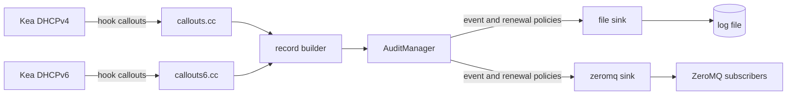

# Kea IP Audit Hook

A hook library for the [Kea DHCPv4 and DHCPv6 servers](https://www.isc.org/kea/) that records
**who got which IP address or delegated prefix and when**, including DHCP relay data that
identifies the subscriber's port or line.

It is intended for ISPs that need to trace an IP address back to a subscriber
(for example for abuse handling or legal data retention requirements).

## What it does

The DHCPv4 and DHCPv6 libraries build an *audit record* for lease assignment, renewal,
release, decline and expiry events and queue it for asynchronous delivery to configurable
**sinks**. DHCPv4 also records deleted leases when a client receives a new address. DHCPv6
records include IA_NA, IA_TA and IA_PD details, DUID/IAID, delegated
prefix length, and relay interface-id and remote-id data.

Two sinks are included:

| Sink type | Purpose |
|-----------|---------|
| `file`    | Appends records to a log file, with size-based rotation. |
| `zeromq`  | Publishes records on a ZeroMQ PUB socket for real-time consumers. |

The bounded queue keeps slow sinks off the DHCP processing path. Records are dropped if
the queue fills; the cumulative count is logged when the hook unloads. The default queue
capacity is 10,000 records and can be changed with `queue-size`.

Optional per-sink renewal controls can suppress unchanged renewals or cap the renewal rate;
both are disabled by default. See [docs/configuration.md](docs/configuration.md).

Sinks are pluggable: new ways of storing records can be added without touching the
hook logic (see [docs/extending.md](docs/extending.md)). Everything is controlled from
the hook `parameters` in the Kea configuration; no recompilation is needed to change
what is logged, where, or in which format.



## Quick start

1. Build and install (Linux, requires Kea development files, libzmq and Boost headers):

   ```sh
   cmake -S . -B build -DKEA_PREFIX=/usr
   cmake --build build
   sudo cmake --install build
   ```

   Or build a DEB/RPM package for easy installation on servers (`cd build && cpack -G DEB`,
   see [docs/operations.md](docs/operations.md#building-install-packages)).

2. Add the matching library to the server configuration. Use `libdhcp_ip_audit.so` in
  `Dhcp4`, or `libdhcp6_ip_audit.so` in `Dhcp6`:

   ```json
   "hooks-libraries": [
     {
       "library": "/usr/lib/kea/hooks/libdhcp_ip_audit.so",
       "parameters": {
         "sinks": [
           { "type": "file", "path": "/var/log/kea/ip-audit.log" }
         ]
       }
     }
   ]
   ```

3. Restart or reconfigure Kea. Each lease event now produces one JSON line:

   ```json
   {"timestamp":"2026-10-30T12:00:00.123Z","event":"lease-assign","ip-address":"192.0.2.10","hw-address":"aa:bb:cc:dd:ee:ff","subnet-id":1,"valid-lifetime":3600,"circuit-id":"0004000a0001","remote-id":"0a1b2c3d4e5f","giaddr":"192.0.2.1"}
   ```

A complete example with both sinks is in [examples/kea-dhcp4.conf](examples/kea-dhcp4.conf).
The DHCPv6 configuration example is [examples/kea-dhcp6.conf](examples/kea-dhcp6.conf).

## Documentation

- [docs/architecture.md](docs/architecture.md) - how the hook works internally
- [docs/configuration.md](docs/configuration.md) - every configuration parameter
- [docs/fields.md](docs/fields.md) - the fields and events in an audit record
- [docs/extending.md](docs/extending.md) - adding a new sink
- [docs/operations.md](docs/operations.md) - building, testing, deploying, consuming data, privacy and limitations
- [docs/roadmap.md](docs/roadmap.md) - suggested improvements for ISP use

## Requirements

- Kea DHCPv4 and/or DHCPv6 with hooks support (development headers and `kea-msg-compiler`)
- libzmq
- Boost (headers only)
- A C++17 compiler and CMake 3.16+
- Linux or another POSIX system (the file sink uses POSIX I/O)
