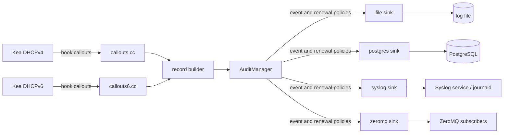

# Kea IP Audit Hook

A hook library for the [Kea DHCPv4 and DHCPv6 servers](https://www.isc.org/kea/) that records
**who got which IP address or delegated prefix and when**, including DHCP relay data that
identifies the subscriber's port or line.

It is intended for ISPs that need to trace an IP address back to a subscriber
(for example for abuse handling or legal data retention requirements).

## What it does

The DHCPv4 and DHCPv6 libraries build an *audit record* for lease assignment, renewal,
release, decline and expiry events and queue it for asynchronous delivery to configurable
**sinks**. DHCPv4 also records deleted leases when a client receives a new address, along
with vendor/user classes and relay option-82 details. Optional subnet POP/site metadata is
read from Kea's `user-context`. Every record includes the local server host name for HA
log correlation. DHCPv6 records include IA_NA, IA_TA and IA_PD details,
DUID/IAID, delegated prefix length, and relay interface-id and remote-id data.

Four sinks are included:

- **File:** Appends records with size/time rotation, age-based retention and optional gzip compression.
- **PostgreSQL:** Stores every event and maintains indexed lease-history intervals.
- **Syslog:** Sends formatted records through the host's syslog service; journald can receive them through its syslog socket.
- **ZeroMQ:** Publishes records on a PUB socket for real-time consumers.

The bounded queue keeps slow sinks off the DHCP processing path. Records are dropped if
the queue fills; the cumulative count is logged when the hook unloads. The default queue
capacity is 10,000 records and can be changed with `queue-size`.

Optional per-sink renewal controls can suppress unchanged renewals or cap the renewal rate;
both are disabled by default. See [docs/configuration.md](docs/configuration.md).

Sinks are pluggable: new ways of storing records can be added without touching the
hook logic (see [docs/extending.md](docs/extending.md)). Everything is controlled from
the hook `parameters` in the Kea configuration; no recompilation is needed to change
what is logged, where, or in which format.



## Quick start

### 1. Install a matching package

Download a DEB or RPM from
[GitHub Releases](https://github.com/solvationab/KeaLogHook/releases), or use the
Cloudsmith repository's **Set Me Up** link in the release notes. Choose the exact
distribution and Kea version used by your server; hook binaries are not portable
across arbitrary Kea versions.

```sh
# Ubuntu: use the downloaded DEB for your Ubuntu release.
sudo apt install ./kea-ip-audit-hook_*.deb
# Enterprise Linux 9: use the downloaded EL9 RPM instead.
sudo dnf install ./kea-ip-audit-hook-*.rpm
```

Run only the command for your distribution, with one matching package in the directory.
Packages include both hook libraries, all five CLI commands, and examples.
For a source build, see [Building](docs/operations.md#building).

### 2. Find the installed hook path

Do not assume `/usr/lib/kea/hooks`: Ubuntu commonly uses a multiarch directory and EL9
uses `/usr/lib64/kea/hooks`.

```sh
dpkg-query -L kea-ip-audit-hook | grep -E 'libdhcp.*ip_audit.so$'  # Ubuntu
rpm -ql kea-ip-audit-hook | grep -E 'libdhcp.*ip_audit.so$'        # EL9
```

### 3. Configure Kea

Merge the following entry into the `hooks-libraries` list inside your existing `Dhcp4`
configuration, usually in `/etc/kea/kea-dhcp4.conf`. Replace the example library path
with the path from step 2. Keep any existing hooks and DHCP settings.

```json
{
  "library": "/usr/lib/x86_64-linux-gnu/kea/hooks/libdhcp_ip_audit.so",
  "parameters": {
    "sinks": [
      { "type": "file", "path": "/var/log/kea/ip-audit.log", "format": "json" }
    ]
  }
}
```

For DHCPv6, use the installed `libdhcp6_ip_audit.so` path in `Dhcp6` and log to
`/var/log/kea/ip-audit6.log`. These examples are hook fragments, not complete server
configurations. JSON defaults retain all non-empty fields, including lease expiry and
CID/RID hex and escaped-ASCII text.

### 4. Check log access and load the hook

The Kea service user needs write access to `/var/log/kea` to create and rotate logs.
Ubuntu commonly uses `_kea`; verify the account and directory before changing permissions:

```sh
systemctl show kea-dhcp4-server -p User -p Group
namei -l /var/log/kea/ip-audit.log
sudo kea-dhcp4 -t /etc/kea/kea-dhcp4.conf
sudo systemctl restart kea-dhcp4-server
sudo journalctl -u kea-dhcp4-server --since "5 minutes ago" --no-pager
```

Restart only during an acceptable DHCP service interruption. EL9 service names may
differ (`kea-dhcp4`); use your distribution's unit and configuration paths. Look for
`IP_AUDIT_LOAD_OK`. If loading fails, find the preceding `IP_AUDIT_LOAD_FAILED` reason.
Package AppArmor rules cover the default audit paths; custom paths need administrator
policy. See [Package security policy](docs/operations.md#package-security-policy).

### 5. Verify records and commands

Trigger a client allocation or renewal; installing the hook does not backfill leases
that already exist.

```sh
sudo tail -n 1 /var/log/kea/ip-audit.log
ip-audit-lookup --help
ip-audit-list --help
ip-audit-subscriber --help
ip-audit-check --help
ip-audit-report --help
sudo ip-audit-list /var/log/kea/ip-audit.log
```

An extended file/ZeroMQ example is in [examples/kea-dhcp4.conf](examples/kea-dhcp4.conf).
The DHCPv6 hook fragment is [examples/kea-dhcp6.conf](examples/kea-dhcp6.conf).
Minimal sink objects are available for [file](examples/sink-file.json),
[PostgreSQL](examples/sink-postgres.json), [syslog](examples/sink-syslog.json), and
[ZeroMQ](examples/sink-zeromq.json).

## Looking Up Lease History

`ip-audit-lookup` reconstructs the lease timeline for an address at a timestamp from a base
log and its numbered or compressed rotations:

```sh
ip-audit-lookup 192.0.2.10 2026-10-31T12:00:00Z /var/log/kea/ip-audit.log
```

See [docs/operations.md](docs/operations.md#looking-up-lease-history) for event handling and
exit codes.

To list currently allocated addresses and delegated prefixes in readable form:

```sh
ip-audit-list /var/log/kea/ip-audit.log /var/log/kea/ip-audit6.log
```

All five commands default to readable output. Add `--json` for JSON or `--table` for
tab-separated columns, for example:

```sh
ip-audit-list --json /var/log/kea/ip-audit.log > allocations.json
ip-audit-list --table /var/log/kea/ip-audit.log
ip-audit-lookup --json 192.0.2.10 2026-10-31T12:00:00Z /var/log/kea/ip-audit.log
```

Allocation lists are inferred from available audit events, not queried from Kea's live lease
database. See [docs/operations.md](docs/operations.md#listing-current-allocations) for
limitations.

Search a time range for one exact subscriber identifier across address changes:

```sh
ip-audit-subscriber --type circuit-id --value 706f72742d372f33 \
  --from 2026-10-01T00:00:00Z --to 2026-11-01T00:00:00Z \
  /var/log/kea/ip-audit.log
```

See [docs/operations.md](docs/operations.md#searching-subscriber-history) for supported
identifiers, output formats, and privacy limitations.

## Validating Audit Logs

`ip-audit-check` reports per-file event counts, time coverage, errors, and reconstruction
warnings across plain and compressed rotations:

```sh
ip-audit-check /var/log/kea/ip-audit.log /var/log/kea/ip-audit6.log --json
```

See [docs/operations.md](docs/operations.md#validating-audit-logs) for severity rules and
exit codes.

## Reporting Aggregate Activity

`ip-audit-report` summarizes event counts by UTC time bucket, POP, site, event, and address
family without including client or relay identifiers:

```sh
ip-audit-report --bucket daily --from 2026-10-01T00:00:00Z \
  --to 2026-11-01T00:00:00Z /var/log/kea/ip-audit.log
```

See [docs/operations.md](docs/operations.md#reporting-aggregate-activity) for bucket sizes,
filters, and output formats.

## Documentation

- [docs/architecture.md](docs/architecture.md) - how the hook works internally
- [docs/configuration.md](docs/configuration.md) - every configuration parameter
- [docs/fields.md](docs/fields.md) - the fields and events in an audit record
- [docs/extending.md](docs/extending.md) - adding a new sink
- [docs/operations.md](docs/operations.md) - building, testing, deploying, operator commands, privacy and limitations
- [docs/developer/integration.md](docs/developer/integration.md) - developing consumers, reference listener, fixtures and test publisher
- [docs/developer/wire-format.md](docs/developer/wire-format.md) - ZeroMQ framing, topics and payload encodings
- [docs/developer/compatibility.md](docs/developer/compatibility.md) - schema versions and forward-compatible reading
- [docs/developer/recovery.md](docs/developer/recovery.md) - delivery guarantees, reconciliation and consumer security
- [docs/roadmap.md](docs/roadmap.md) - suggested improvements for ISP use

## Build Requirements

- Kea DHCPv4 and/or DHCPv6 with hooks support (development headers and `kea-msg-compiler`)
- libzmq and libpq (PostgreSQL client library)
- Python 3.7+ to run the installed CLI commands; Python 3 for integration tests
- Boost (headers only)
- A C++17 compiler and CMake 3.16+
- Linux or another POSIX system (the file sink uses POSIX I/O)
