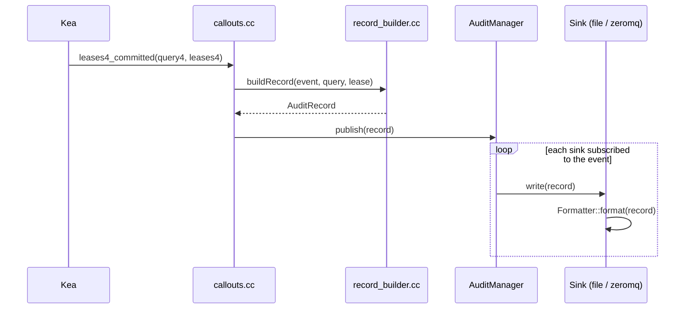
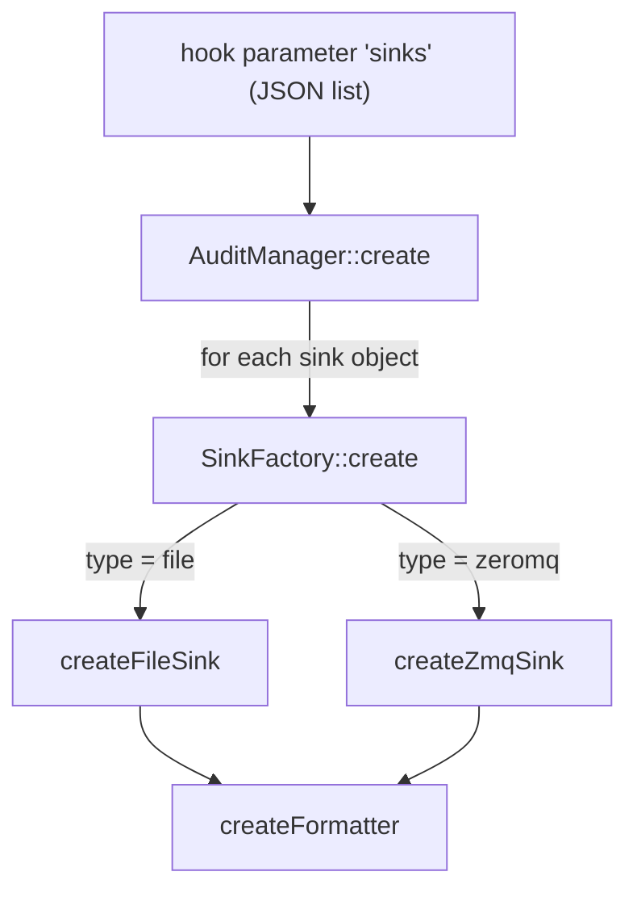

# Architecture

## Overview

The hook is a Kea hook library loaded into `kea-dhcp4`. It registers callouts on
lease-related hook points, converts each event to an `AuditRecord` (an ordered list of
name/value fields) and delivers it to every configured sink.

## Source layout

| File | Responsibility |
|------|----------------|
| `src/callouts.cc` | Library entry points (`version`, `load`, `unload`, `multi_threading_compatible`) and the Kea callouts. |
| `src/record_builder.*` | Builds an `AuditRecord` from the client packet (`Pkt4`) and the `Lease4`. Decodes option 82. |
| `src/audit_record.h` | The `AuditRecord` type plus the lists of known field and event names. |
| `src/audit_manager.*` | Parses the `sinks` parameter, owns the sinks, applies per-sink event filters and isolates sink failures. |
| `src/sink.h` | The abstract `Sink` interface. |
| `src/sink_factory.*` | Maps the `type` string of a sink to its implementation. |
| `src/file_sink.*` | File sink with size-based rotation. |
| `src/zmq_sink.*` | ZeroMQ PUB sink. |
| `src/formatter.*` | `json` and `template` formatters, plus the `Template` placeholder engine. |
| `src/config_util.*` | Typed, validating accessors for Kea configuration elements. |
| `src/ip_audit_messages.mes` | Kea log message definitions (compiled by `kea-msg-compiler`). |
| `src/ip_audit_log.*` | The hook's logger (`ip-audit-hooks`). |
| `tests/` | GoogleTest unit tests, plus `tests/integration/` (real Kea with a simulated relay). All sources except `callouts.cc` are built into the static library `ip_audit_core`, which the tests link. |

## Hook points

| Hook point | Event emitted | Notes |
|------------|---------------|-------|
| `leases4_committed` | `lease-assign` or `lease-renew` | One record per committed lease. |
| `lease4_renew` | - | Only sets a flag on the packet's callout context so that `leases4_committed` can emit `lease-renew` instead of `lease-assign`. |
| `lease4_release` | `lease-release` | Triggered by DHCPRELEASE. |
| `lease4_decline` | `lease-decline` | Triggered by DHCPDECLINE. |
| `lease4_expire` | `lease-expire` | Triggered by lease reclamation. No client packet exists, so relay and packet fields are empty. |

## Load, run and unload

- **Load:** `load()` reads the `sinks` parameter, creates all sinks and registers the
  callouts. Any configuration error (unknown key, bad value, sink that cannot be opened,
  unreachable bind address) is logged as `IP_AUDIT_LOAD_FAILED` and `load()` returns 1,
  so Kea refuses to start or reconfigure with a broken configuration instead of silently
  not logging.
- **Run:** callouts never throw into Kea. A failing sink is logged
  (`IP_AUDIT_SINK_WRITE_FAILED`) and the other sinks and DHCP processing continue.
- **Unload:** the manager and all sinks are destroyed, files are closed and ZeroMQ
  sockets and contexts are shut down.

## Threading

The library declares itself multi-threading compatible. Callouts can run concurrently, so
each sink serialises access to its own resource with a mutex (the file descriptor, the
ZeroMQ socket). Formatting happens outside the lock.

## Configuration flow

Parsing is strict: unknown keys are rejected so typos are caught at load time rather
than ignored.
