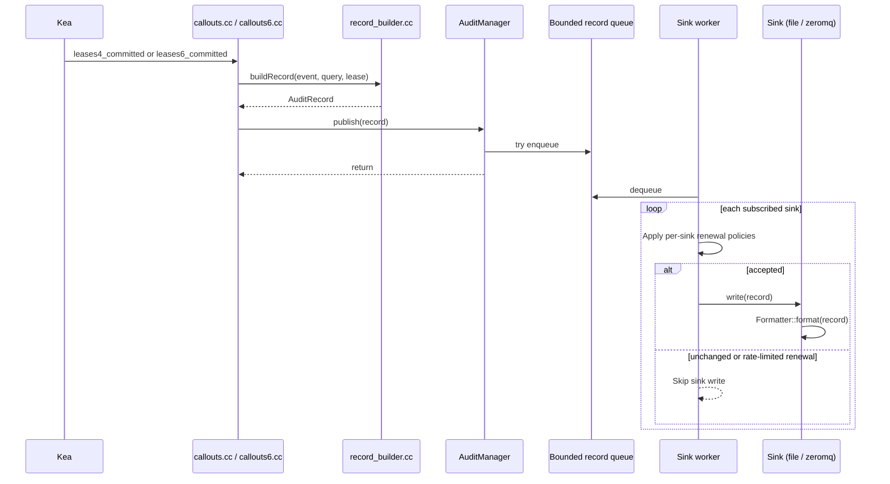
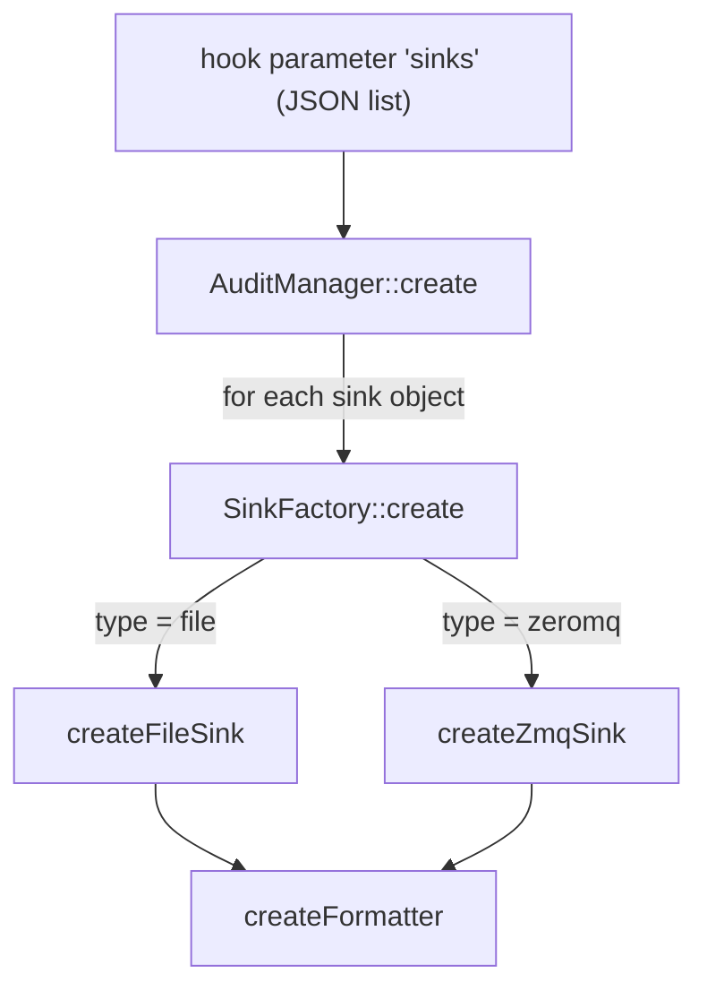

# Architecture

## Overview

The DHCPv4 and DHCPv6 hook libraries register callouts on lease-related hook points,
convert each event to an `AuditRecord` (an ordered list of name/value fields) and deliver
it to every configured sink.

## Source layout

| File | Responsibility |
|------|----------------|
| `src/callouts.cc` | Library entry points (`version`, `load`, `unload`, `multi_threading_compatible`) and the Kea callouts. |
| `src/callouts6.cc` | DHCPv6 library entry points and callouts. |
| `src/record_builder.*` | Builds records from `Pkt4`/`Lease4` or `Pkt6`/`Lease6`; adds the local server host name and decodes DHCPv4 client classes, option 82, DHCPv6 relay options and subnet `user-context` metadata. |
| `src/audit_record.h` | The `AuditRecord` type plus the lists of known field and event names. |
| `src/audit_manager.*` | Parses sinks, owns the bounded record queue and worker, applies per-sink event and renewal policies, and isolates sink failures. |
| `src/record_queue.*` | Bounded FIFO queue; rejects new records when full and drains accepted records on shutdown. |
| `src/sink.h` | The abstract `Sink` interface. |
| `src/sink_factory.*` | Maps the `type` string of a sink to its implementation. |
| `src/file_sink.*` | File sink with size-based rotation. |
| `src/zmq_sink.*` | ZeroMQ PUB sink. |
| `src/formatter.*` | `json` and `template` formatters, plus the `Template` placeholder engine. |
| `src/config_util.*` | Typed, validating accessors for Kea configuration elements. |
| `src/ip_audit_messages.mes` | Kea log message definitions (compiled by `kea-msg-compiler`). |
| `src/ip_audit_log.*` | The hook's logger (`ip-audit-hooks`). |
| `tests/` | GoogleTest unit tests, plus `tests/integration/` (real DHCPv4 Kea with a simulated relay). Core sources are built into `ip_audit_core`, which the tests link. |

## Hook points

| Hook point | Event emitted | Notes |
|------------|---------------|-------|
| `leases4_committed` | `lease-assign`, `lease-renew` or `lease-delete` | Records committed leases and each old lease in the `deleted_leases4` argument. |
| `lease4_renew` | - | Only sets a flag on the packet's callout context so that `leases4_committed` can emit `lease-renew` instead of `lease-assign`. |
| `lease4_release` | `lease-release` | Triggered by DHCPRELEASE. |
| `lease4_decline` | `lease-decline` | Triggered by DHCPDECLINE. |
| `lease4_expire` | `lease-expire` | Triggered by lease reclamation. No client packet exists, so relay and packet fields are empty. |
| `leases6_committed` | `lease-assign` or `lease-renew` | One record per committed IA_NA, IA_TA or IA_PD lease. |
| `lease6_renew`, `lease6_rebind` | - | Mark the packet context so `leases6_committed` can emit `lease-renew`. |
| `lease6_release` | `lease-release` | Triggered by a DHCPv6 Release. |
| `lease6_decline` | `lease-decline` | Triggered by a DHCPv6 Decline. |
| `lease6_expire` | `lease-expire` | Triggered by lease reclamation; no client packet exists. |

## Load, run and unload

- **Load:** `load()` reads the `sinks` parameter, creates all sinks and registers the
  callouts. Any configuration error (unknown key, bad value, sink that cannot be opened,
  unreachable bind address) is logged as `IP_AUDIT_LOAD_FAILED` and `load()` returns 1,
  so Kea refuses to start or reconfigure with a broken configuration instead of silently
  not logging.
- **Run:** callouts enqueue records for asynchronous delivery and never wait for sink writes.
  A full queue drops the newest record; the cumulative drop count is logged at unload as
  `IP_AUDIT_QUEUE_OVERFLOW`. A failing sink is logged (`IP_AUDIT_SINK_WRITE_FAILED`) and
  other sinks continue receiving records.
- **Unload:** the queue stops accepting records and the worker drains accepted records
  before sinks are destroyed, files are closed and ZeroMQ sockets and contexts are shut down.

## Threading

The library declares itself multi-threading compatible. Callouts can run concurrently and
enqueue records under the queue mutex. A single worker owns delivery, so sink writes do not
run on the DHCP path; each sink also protects its own resource with a mutex. Formatting
happens outside each sink's resource lock.

## Configuration flow

Parsing is strict: unknown keys are rejected so typos are caught at load time rather
than ignored.
